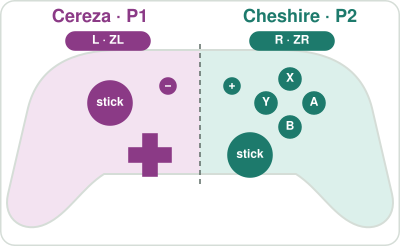
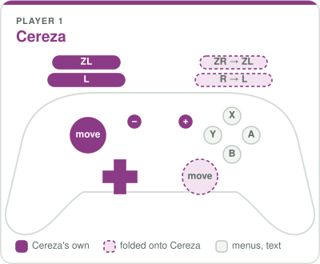
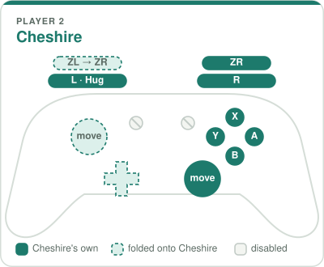

# Bayonetta Origins Co-op

Local two-player co-op for *Bayonetta Origins: Cereza and the Lost Demon* (Nintendo Switch).
**Player 1 plays Cereza, Player 2 plays Cheshire**, each on their own controller.

> **Status: beta.** Tested on the Eden emulator only. Real hardware is untested and not supported yet
> (see [Real hardware](#real-hardware)).

## Requirements

- The game, version 1.0.0 (title ID `0100CF5010FEC000`, build ID `a1ce2940d813acaba84073fdcc103d09caf93ded`).
  On any other build the mod detects the mismatch and does nothing.
- A Switch emulator. Tested on **Eden**. Other yuzu-family emulators should behave the same; Ryujinx is untested.
- Two controllers, set up as **Player 1** and **Player 2** in the emulator's controller settings.

## Install

1. Download `BayonettaOrigins-Coop-<version>-emulator.zip` from the
   [Releases](https://github.com/chokercrave/bayonetta-origins-coop/releases) page.
2. Extract it into the emulator's mod folder, so that you end up with
   `…/load/0100CF5010FEC000/Origins Coop/exefs/subsdk8`:

   | Emulator | Mod folder (extract here) |
   |---|---|
   | Eden / yuzu-family | right-click the game → *Open Mod Data Location*, or `%APPDATA%\eden\load\` on Windows |
   | Ryujinx (untested) | right-click the game → *Open Mods Directory*; put `Origins Coop` inside `0100CF5010FEC000` there |

3. Make sure *Origins Coop* is ticked in the game's *Properties → Add-Ons*.
4. Connect two controllers as Player 1 and Player 2, and start the game.

With no Player 2 controller connected the game plays exactly like the original (one player controls both
characters), so the mod can stay installed for solo play.

It can be installed together with other code mods for the game (for example a dynamic-FPS mod) as long as they use a
different slot: this mod uses `subsdk8` and ships no `main.npdm`.

## Controls

The original game already splits one controller in half: the left half moves and acts for Cereza, the right half for
Cheshire. The mod builds that controller from two. Each player holds a full controller, and the half that would belong
to the other character is folded onto their own.

<p align="center"></p>

<p align="center">
  
  
</p>

Solid buttons are the character's own, dashed ones are the other half of the controller folded onto the same actions.
The full illustrated guide, with situations and menu handling, is [CONTROLS.html](CONTROLS.html) (also in the release
zip; open it in a browser).

| Action | Player 1 (Cereza) | Player 2 (Cheshire) |
|---|---|---|
| Move | either stick | either stick |
| Interact (Cereza's L actions) | L or R | — |
| Umbran Arts, Witch Pulse | ZL or ZR | — |
| Attack | — | ZL or ZR |
| Pick Cheshire up (Hug Mode) | — | L |
| Send Cheshire out / stretch him in Hug Mode | — | R |
| Aim Cheshire's stretch in Hug Mode | — | stick |
| Element forms | — | A / B / X / Y, or the D-pad (← Y, ↑ X, → A, ↓ B) |
| D-pad | D-pad | — |
| Pause, map | + / − | disabled |

Player 1's A / B / X / Y do nothing during normal play (they are Cheshire's buttons), but they work in menus and on
text, see below.

**Hug Mode is Player 2's.** In the original game Cereza's L both interacts and picks Cheshire up, and the game decides
which one you meant. With two players, only Player 2's L puts Cheshire into Hug Mode, so Cheshire comes and goes on his
own player's terms; Player 1's L still interacts with everything else. With no Player 2 connected, L works as in the
original game.

**Menus and text.** The mod reads what the game is doing and switches by itself:

- **Menus and pop-up windows** (pause menu, title and main menu, windows that stop the game, the D-pad menu):
  Player 1's controller works as a normal controller. A confirms, B goes back, ZL / ZR and L / R switch tabs.
  Player 2 is ignored until the menu closes.
- **Text on screen** (dialogue, Cereza's comments when examining something, voice lines while you keep playing):
  co-op goes on, so Player 2 can still move Cheshire, and Player 1's A advances or closes the text.
- **Practice Room** (from the skill tree): both players play, and Player 1's A / B / X / Y also work, so Player 1 can
  pick the skill and enemy in the room's windows. Those buttons are Cheshire's, so they can switch his element too.

**Single Joy-Cons held sideways.** One Joy-Con per player also works. The game's own sideways layout has no ZL / ZR, so
the mod maps them per character: for Cereza SR = ZL and SL = L, for Cheshire SR = attack, SL = R and the stick click
= L (Hug Mode).

## Known limitations

- **Map (−):** still uses the co-op split instead of giving Player 1 a normal controller.
- **Calling Cheshire back:** Player 1's stick click can still call Cheshire back from a distance, as in the original
  game.
- **Controller applet:** if the game opens the system controller screen (for example after a disconnect), it asks for
  one player and may drop Player 2. Reconnect Player 2 afterwards.
- **Button icons:** with Player 1 in handheld mode and Player 2 connected, on-screen button icons may follow Player 2's
  controller type.
- **Tutorial windows:** not every kind of pop-up has been seen in testing. If one does not accept Player 1's A,
  Player 2's A closes it. Please open an issue with where it happened.

## Real hardware

Not supported yet. It may well work, but nobody has tried it, and two things need care:

- exlaunch needs system calls that the game's own `main.npdm` does not grant (`MapProcessMemory`,
  `UnmapProcessMemory`, `CreateSession`, `ReplyAndReceive`). Emulators don't enforce this; a real Switch does. The
  `config.json` in this repo already generates a matching `main.npdm` (same services, flags and kernel capabilities as
  the game's, plus those calls), but it hasn't been tested on a console.
- On a console, two Joy-Cons default to one player in dual mode, and the game's controller applet is set up for a single
  player. Both need testing.

If you test on hardware with Atmosphère, please open an issue with the result.

## Build

Needs devkitA64 + libnx (`DEVKITPRO` set), or Docker with the `devkitpro/devkita64` image.

```sh
sh build.sh                                              # deploy/subsdk8 and dist/Origins Coop/exefs/subsdk8
cmake -S . -B cmake-build && cmake --build cmake-build   # the same, through CMake (wraps build.sh)
```

### Options

Compile-time switches in [source/program/config.hpp](source/program/config.hpp). Change them there, or add them to
`C_FLAGS` in `config.mk` (for example `C_FLAGS := -DCOOP_P2_HUG=0`).

| Option | Default | Meaning |
|---|---|---|
| `COOP_P1_STICK` / `COOP_P2_STICK` | 2 | Stick that moves the character: 0 = left, 1 = right, 2 = whichever is pushed further |
| `COOP_P1_FACE_TO_DPAD` | 0 | 1 = Player 1's face buttons press the D-pad. Off because the D-pad opens a menu during play |
| `COOP_P2_DPAD_TO_FACE` | 1 | Player 2's D-pad presses the face buttons (elements) |
| `COOP_P2_HUG` | 1 | Hug Mode is Player 2's (their L). 0 = original split: Player 1's L starts it, Player 2's L acts as R |
| `COOP_MENU_TOGGLE` | 1 | Menu and text handling described above. 0 = the co-op split everywhere |
| `COOP_SINGLE_JOYCON` | 1 | Accept single sideways Joy-Cons |
| `COOP_DIAG` | 0 | Extra `[ORCOOP]` diagnostics in the emulator log (button presses, memory changes; ~6 MB) |

Every mode switch is logged as an `[ORCOOP] mode PLAY/TEXT/MENU (…)` line in the emulator log, which helps when
reporting a problem.

## How it works

The game binary is stripped: only Nintendo SDK imports have names, so there is no character controller to hook.
The mod works at the game's input boundary instead. Offsets are relative to `main`'s `.text`.

| What | Where |
|---|---|
| hid setup: `SetSupportedNpadIdType({No1, Handheld})`, `SetSupportedNpadStyleSet(7)` | `0xFFC66C` |
| Input manager, once per frame: polls the No1 and Handheld pads, merges them | `0x122E44C` |
| `PollPad(pad, GameInput*)`: `GetNpadState`, sticks / 32767, game button bits | `0x1530EA4` |

Hooks:

1. **`0xFFC680`**, after `SetSupportedNpadIdType`: calls it again with `{No1, No2, Handheld}`, otherwise the system
   never reports a Player 2 controller.
2. **`0xFFC688`**: `SetSupportedNpadStyleSet(7)` becomes `0x1F`, adding single Joy-Cons (`PollPad` already handles
   them).
3. **`0x122E6C8`**, after the second `PollPad`: polls Player 2 through the game's own `PollPad`, builds one controller
   from both players (Player 1 → left half, Player 2 → right half) and writes it where the game reads its input.
4. **`0x8EA254`**, in Cereza's update after her action table is reset: Cereza keeps an action → button table at
   `+0x2664`. Actions 0, 16 and 20 are all L, and action 16 is Hug Mode, tested by 23 of her state handlers. While
   co-op is on, action 16 is mapped to `0x10000000`, a bit the game's button layout does not use and that only Player
   2's L sets. When two actions share a button the game asks `0x99F744` which one a press meant (`0x9ED708`), so it
   already supports a separate hug button, and its own action locks keep working.
5. **`0x11FE304`** / **`0x1203AFC`**: the Practice Room opening and closing. The room keeps UI mode bit 1 set for the
   whole session, and dozens of other windows share that bit, so the room is tracked on its own.

Menu and text detection reads the game's own state, all found by watching memory during play and confirmed in the
code where possible:

| State | Address | Used for |
|---|---|---|
| Pause menu open | `0x1DB5280` bit `0x10000` | menus |
| Title / main menu | `0x1DB5260` bit `0x200` | menus |
| World stopped (pause, pop-ups) | `0x1DB5260` bit `0x4000` | menus |
| UI mode (0 in play; 1 pop-up, 4 / 5 D-pad menu, `0x800` dialogue) | `0x4FF0074` | menus, or text for `0x800` |
| Event request queue count (dialogue) | `0x1DB53B0` | text |
| Message on screen (the game skips actor logic while set, 85 code sites) | `0x5036648` / `0x503664C` | text |
| Practice Room open (hooks 5) | — | text, and UI mode bit 1 is not a menu |

Each hook site's instruction word is checked at boot; on a different game build the mod logs `MISMATCH` and installs
nothing.

## Credits

- [exlaunch](https://github.com/shadowninja108/exlaunch) by shadowninja108, the code injection framework
  (`source/lib`, `source/rtld`, `misc`).
- The exlaunch setup was adapted from [bayonetta3-dynamic-fps](https://github.com/yogesh1239/bayonetta3-dynamic-fps).

## License

GPL-2.0, see [LICENSE](LICENSE). This project contains no game code or assets; you need your own copy of the game.
It is a fan project, not affiliated with Nintendo or PlatinumGames.
